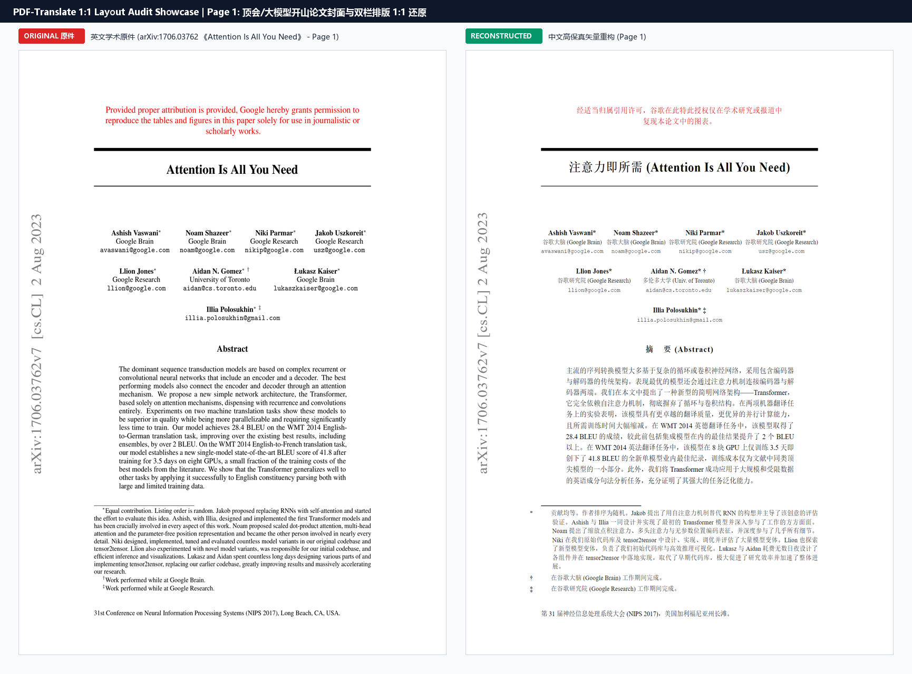
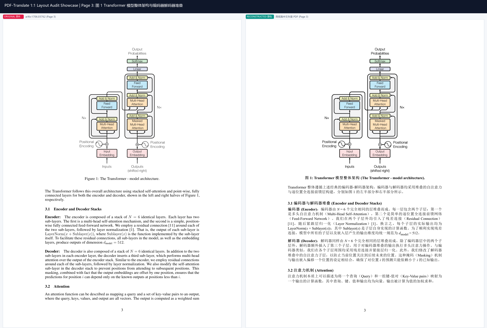
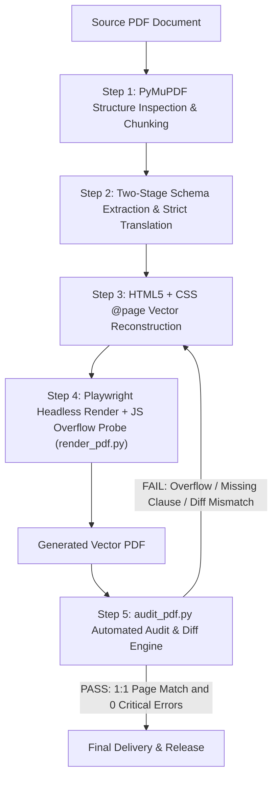

<p align="center">
  <a href="README.md">简体中文</a> | <b>English</b>
</p>

# 📄 PDF-Translate Skill

> **High-Fidelity Vector PDF Translation, Layout Reconstruction & Automated Audit Engine for AI Agents.**  
> Powered by LLM direct comprehension, two-stage data-contract translation, in-browser physical height overflow detection, and automated 1:1 bidirectional page audit.

[](https://github.com/lxsssssss/pdf-translate/actions/workflows/ci.yml)
[](LICENSE)
[](https://www.python.org/)
[](https://playwright.dev/)
[](https://pymupdf.readthedocs.io/)

[](https://antigravity.google)
[](https://claude.ai)
[](https://cursor.com)
[](https://codeium.com/windsurf)
[](https://openai.com)
[](https://github.com/lxsssssss/pdf-translate)
[](https://deepseek.com)

---

## 📸 Before & After Showcase

> **Real-World Case Study**: The landmark foundation paper of modern deep learning, *Attention Is All You Need* (arXiv:1706.03762), featuring multi-author affiliation grids, precision margin watermark alignment, dual-column abstract, mathematical footnotes, and strict height overflow protection.

### 1. Academic Paper Cover & Dual-Column Layout (1:1 Reconstruction)


### 2. Complex Model Architecture & Physical Anchor Alignment (1:1 Figure 1 Reconstruction)


---

## 🌟 The Core Problem & Solution (Why PDF-Translate?)

Traditional document translation tools (such as general machine translation or conventional OCR exports) often suffer from four fatal flaws when dealing with **engineering bids, cross-border contracts, statutory certificates, and academic whitepapers**:

1. **Layout Collapse**: Tables misalign, signature boxes are severed, page numbers drift, and table of contents dot leaders scatter.
2. **Raster Blur**: Text is rendered into low-resolution bitmap images, making it unselectable, unsearchable, and blurry.
3. **AI Hallucinations**: Long-context LLMs take creative liberties, "summarizing" legal clauses, altering sub-clause numbering, or fabricating non-existent numbers.
4. **Cross-Page Overflow**: Post-translation text length differences break page physical heights, causing phantom blank pages and misaligned spreads.

**`pdf-translate`** solves these challenges by combining LLM structured data extraction with modern CSS `@page` vector layout and automated post-generation self-healing audits.

---

## 🚀 Key Features

- 🎯 **1:1 Strict Layout Preservation**
  - Strictly preserves physical page dimensions (standard A4, Letter, etc.), margins, and layout proportions.
  - Reconstructs bilingual comparison tables, dual-column official headers, dotted leaders, and signature/stamp boxes.
- 🚫 **Zero-Hallucination Two-Stage Pipeline**
  - **Stage 1 (Contract Extraction)**: Extracts clause hierarchy trees, numbers, parameters, and tables into a structured schema before translation.
  - **Stage 2 (Template Population)**: Forbids omission, compression, or common-sense fabrication of clauses (e.g. statutory items 2.1.1~2.1.8).
- 📐 **In-Browser Physical Height Overflow Probe**
  - Injects a JavaScript probe during headless rendering to monitor `scrollHeight` vs `clientHeight` of every `.page` container in real time.
  - Automatically flags and intercepts microscopic overflows before print generation.
- 🖨️ **Publication-Grade Vector PDF Generation**
  - Powered by headless Chromium / Edge, generating crystal-clear, selectable, searchable, and fully vector output.
- 🔍 **Automated 1:1 Audit Engine (`scripts/audit_pdf.py`)**
  - **Page Count & Size Verification**: Page count must match 1:1 and every page size must match (catches Letter rendered as A4).
  - **Vector, Image & Font Checks**: No full-page raster scans; per-page image count/size; non-embedded fonts and U+FFFD glyphs.
  - **Clause / Reference / Number Diff**: Sub-clause numbers, cross-language Section/Appendix/Table/Figure refs, and key numbers (amounts, years).
  - **Source-Aware Placeholder Radar**: Flags filler like "TBD", "Omitted due to length" only when absent from the source.
  - **Side-by-Side PNGs**: `--compare-png` renders source|target comparison images.

---

## 🏗️ Architecture & Workflow



---

## 📂 Repository Structure

```text
pdf-translate/
├── .github/
│   ├── workflows/ci.yml     # Automated CI testing workflow
│   └── ISSUE_TEMPLATE/      # Community bug & feature request templates
├── SKILL.md                 # Antigravity / AI Agent Core Skill Specification (Chinese)
├── SKILL_EN.md              # Antigravity / AI Agent Core Skill Specification (English)
├── requirements.txt         # Core Python dependencies (PyMuPDF, Playwright)
├── requirements-dev.txt     # Dev / test dependencies (pytest)
├── LICENSE                  # MIT License
├── README.md                # Chinese Documentation
├── README_EN.md             # English Documentation
├── assets/                  # 1:1 Real-world comparison showcases
├── examples/                # Quick start demo and sample templates
│   ├── sample_source.html   # English source sample (audit --src)
│   ├── sample_doc.html      # Its Chinese translation (audit --tgt, unified A4 page convention)
│   └── quick_demo.py        # One-click E2E: render source + translation → audit → comparison PNG
├── scripts/
│   ├── audit_pdf.py         # Page-by-page audit: count/size/vector/images/fonts/clauses/refs/numbers/placeholders + PNG
│   ├── keywords.json        # Extensible placeholder / fabrication phrase list
│   └── render_pdf.py        # Playwright renderer (recursive overflow probe + PDF page-count check + browser fallback)
└── tests/                   # pytest: extractor unit tests, defective-translation integration tests, render probe tests
```

---

## 🛠️ Quick Start & Demo

### 1. Installation

```bash
git clone https://github.com/lxsssssss/pdf-translate.git
cd pdf-translate

pip install -r requirements.txt
playwright install chromium
```

### 2. Run the One-Click Demo

Run the built-in demo: it renders an English source and its Chinese translation, audits the translation against the source, and writes a JSON report plus side-by-side PNGs to `examples/output/`:

```bash
python examples/quick_demo.py
```

Output (abridged):
```text
  ✔ PASS: All 1 .page containers (incl. nested clipping boxes) satisfy physical bounds.
  ✔ PASS: PDF page count (1) matches .page containers.
  ✔ PASS: Page count matches exactly (1 pages).
  Page 01: [✔ PASS   ]
>>> AUDIT PASSED <<<
```

Run the test suite:

```bash
pip install -r requirements-dev.txt
python -m pytest
```

---

## 💻 CLI Usage Guide

### 🔹 Vector PDF Rendering (`render_pdf.py`)

Render an HTML template into a physical-bound vector PDF:

```bash
# Basic rendering
python scripts/render_pdf.py input.html output.pdf

# Strict mode: fail immediately if any page has vertical overflow
python scripts/render_pdf.py input.html output.pdf --strict-overflow
```

### 🔹 Automated 1:1 Comparison Audit (`audit_pdf.py`)

Compare original and translated PDFs:

```bash
# Basic audit
python scripts/audit_pdf.py --src original.pdf --tgt translated.pdf

# Strict mode (exit code != 0 on any warning)
python scripts/audit_pdf.py --src original.pdf --tgt translated.pdf --strict

# Output structured JSON audit report
python scripts/audit_pdf.py --src original.pdf --tgt translated.pdf --json audit_report.json

# Side-by-side comparison PNGs (optionally --pages 1,3,5-7)
python scripts/audit_pdf.py --src original.pdf --tgt translated.pdf --compare-png compare_png/

# Ignore legitimate differences (e.g. years) or use a custom phrase list
python scripts/audit_pdf.py --src original.pdf --tgt translated.pdf --ignore "^(19|20)\d\d$" --keywords my_keywords.json
```

---

## 🌐 Multi-Platform AI Agent Ecosystem

This project is architected as an **agnostic, zero-friction universal skill**, natively compatible across leading AI coding assistants and autonomous agent runtimes:

| Platform / Agent | Configuration Path / Format | Key Capabilities |
| :--- | :--- | :--- |
| **Google Antigravity** | `.agent/skills/pdf-translate/` | Native Skill auto-discovery, 5-step SOP execution |
| **Claude Code** | `.claude/skills/pdf-translate/` or custom prompt | Strict adherence to `SKILL_EN.md` schema contracts |
| **Cursor** | `.cursorrules` or `.cursor/rules/` | Bounded `@page` print styles & vector generation |
| **Windsurf (Cascade)** | `.windsurfrules` | Automated invocation of `render_pdf.py` & self-healing |
| **OpenAI Codex** | Custom Instructions / Action | Two-stage schema extraction & template filling |
| **WorkBuddy** | Agent Workflow / Skill Center plugin | 1:1 Tender & contract translation workflows |
| **DeepSeek (V3 / R1)** | System Prompt injection | Deep reasoning clause tree extraction with zero hallucination |

---

### 💻 Quick Integration Guides

#### 1. Google Antigravity
Place this skill inside your workspace under `.agent/skills/pdf-translate`:
```text
your-project/
└── .agent/
    └── skills/
        └── pdf-translate/
            ├── SKILL.md
            ├── SKILL_EN.md
            └── scripts/
```
Prompt: *"Translate this bidding document to Chinese, strictly preserving original layout and outputting as vector PDF."*

#### 2. Claude Code
Clone this repository into a project-level `.claude/skills/pdf-translate/` (or user-level `~/.claude/skills/pdf-translate/`); Claude Code discovers the `SKILL.md` automatically:
```bash
git clone https://github.com/lxsssssss/pdf-translate.git .claude/skills/pdf-translate
```

#### 3. Cursor & Windsurf
This repository includes ready-to-use [`.cursorrules`](.cursorrules) and [`.windsurfrules`](.windsurfrules) in the root directory. Opening this project in Cursor or Windsurf automatically activates these rules.

#### 4. DeepSeek / OpenAI Codex / WorkBuddy
Inject the core rules from `SKILL_EN.md` into your agent's System Prompt, granting Python terminal execution permissions for `scripts/render_pdf.py` and `scripts/audit_pdf.py`.

---

## 📈 Star History

<a href="https://star-history.com/#lxsssssss/pdf-translate&Date">
 <picture>
   <source media="(prefers-color-scheme: dark)" srcset="https://api.star-history.com/svg?repos=lxsssssss/pdf-translate&type=Date&theme=dark&_v=101" />
   <source media="(prefers-color-scheme: light)" srcset="https://api.star-history.com/svg?repos=lxsssssss/pdf-translate&type=Date&_v=101" />
   
 </picture>
</a>

---

## 📄 License

This project is licensed under the [MIT License](LICENSE).
